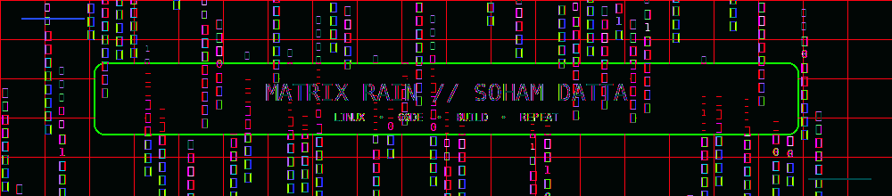
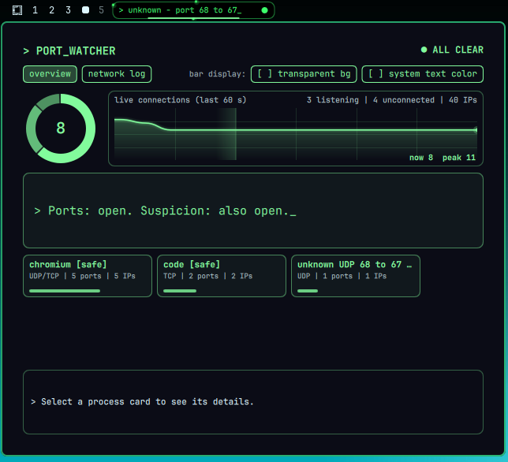

 <!--
  MATRIX × TRON — GITHUB PROFILE
  Repository: https://github.com/soham3301/soham3301
-->

<div align="center">

<!-- ANIMATED FUTURISTIC HEADER -->



<!-- TYPING ANIMATION -->

<a href="https://git.io/typing-svg">
  
</a>

<br/>

<a href="https://www.codekmp.in/">
  
</a>
<a href="https://github.com/soham3301?tab=repositories">
  
</a>
<a href="https://github.com/soham3301">
  
</a>

</div>

---

## `> WHOAMI`

```text
NAME      : Soham Datta
ROLE      : Programming Teacher & Developer
INTERESTS : Software, Linux, Open Source, Computer Science
MINDSET   : Learn. Build. Teach. Repeat.
```

I'm a programming teacher who loves helping students discover the magic of code. I've been coding since childhood, and my curiosity about computers has never stopped growing.

I'm a long-time Linux user, a computer enthusiast, and someone who enjoys exploring how things work beneath the surface.

I like building useful tools, experimenting with ideas, and turning small curiosities into real projects. For me, programming isn't just about writing code — it's about understanding systems, solving problems, and sharing knowledge.

**My mission:** Keep learning, build interesting things, and help the next generation of developers get started.

## `> FEATURED_PROJECT.exe`

<h2> &gt; FEATURED_PROJECT.exe </h2>

<div align="center">

<a href="https://github.com/soham3301/port-watcher">
  
</a>

<br/>

<h3>⚡ Port Watcher</h3>

<p>
My favorite project — explore the code, discover its features,
and follow its development.
</p>

<a href="https://github.com/soham3301/port-watcher">
  
</a>

</div>

## `> OTHER_EXPERIMENTS`

<table>
<tr>
<td width="50%" valign="top">

### 🌀 Omarchy Spinning Disks

An experiment in the Linux desktop customization space.

[**View repository →**](https://github.com/soham3301/omarchy-spinning-disks)

</td>
<td width="50%" valign="top">

### ✨ Display Particles

A visual experiment exploring particles and on-screen effects.

[**View repository →**](https://github.com/soham3301/display-particles)

</td>
</tr>
<tr>
<td width="50%" valign="top">

### 🌧️ Net Rain

A Matrix-inspired experiment involving digital rain and networking.

[**View repository →**](https://github.com/soham3301/net-rain)

</td>
<td width="50%" valign="top">

### 🌐 My Portfolio

My personal corner of the internet, where I share my work and projects.

[**Visit codekmp.in →**](https://www.codekmp.in/)

</td>
</tr>
</table>

## `> TECH_STACK.json`

I'm interested in a broad range of technologies, from low-level programming and desktop environments to web and mobile development.

<div align="center">

### Frontend & Web


### Backend & Databases


### Mobile & Systems


### Tools & Environment


<br/>


</div>

## `> GITHUB_TELEMETRY`

<div align="center">


<br/><br/>


</div>

## `> CONTRIBUTION_MATRIX`

<div align="center">

<!--
  This image requires the GitHub Actions workflow described below.
  The workflow generates the SVG on the output branch.
-->


</div>

---

<div align="center">

### `01001100 01000101 01000001 01010010 01001110`

**Stay curious. Keep building. Share what you learn.**

<sub>Designed in the spirit of the Matrix × TRON digital frontier.</sub>


</div>
